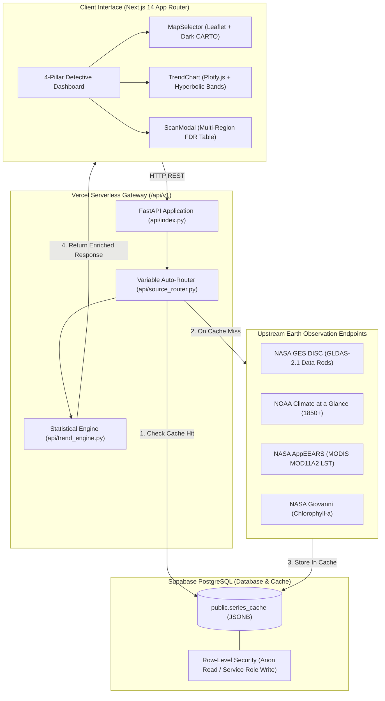

# 🛰️ Trend Detective: NASA Earth Observation Trend & Attribution Platform

[](https://www.spaceappschallenge.org/)
[](https://nextjs.org/)
[](https://fastapi.tiangolo.com/)
[](https://supabase.com/)
[](https://vercel.com/)
[](LICENSE)

**Trend Detective** is an advanced Earth observation and climate analytics platform designed to solve one of the most critical challenges in planetary data science: **distinguishing true, long-term environmental trends from seasonal cycles, serial autocorrelation, and episodic weather shocks.**

Built on a unified Next.js 14 frontend and a high-performance FastAPI statistical engine, Trend Detective bridges multi-decadal NASA and NOAA datasets into an intuitive **4-Pillar Detective Dashboard**. It automates rigorous non-parametric trend tests, calculates true hyperbolic confidence intervals, detects episodic outliers, and silently attributes underlying physical drivers (e.g., precipitation vs. temperature coupling) in real time.

---

## 📌 Table of Contents

- [Core Capabilities](#-core-capabilities)
- [The 4-Pillar Detective Framework](#-the-4-pillar-detective-framework)
- [Earth Observation Data Sources](#-earth-observation-data-sources)
- [Statistical & Mathematical Methodology](#-statistical--mathematical-methodology)
- [Silent Physical Driver Attribution](#-silent-physical-driver-attribution)
- [Curated Benchmark Case Studies](#-curated-benchmark-case-studies)
- [System Architecture](#-system-architecture)
- [Repository Structure](#-repository-structure)
- [Prerequisites & Installation](#-prerequisites--installation)
- [Environment Configuration](#-environment-configuration)
- [Local Development](#-local-development)
- [Database Schema & Migration](#-database-schema--migration)
- [API Reference](#-api-reference)
- [Verification & Automated Tests](#-verification--automated-tests)
- [Vercel Deployment](#-vercel-deployment)
- [Project Roadmap & Issues](#-project-roadmap--issues)

---

## 🚀 Core Capabilities

- **Zero-Jargon Earth System Routing**: Users select natural-language Earth system variables (Evapotranspiration, Soil Moisture, Precipitation, Surface Runoff, Land Surface Temperature); the backend auto-routes queries to optimal NASA/NOAA endpoints without exposing internal archive terminology.
- **Autocorrelation-Aware Trend Detection**: Prevents inflated false positives in climate variables by automatically switching between standard Mann-Kendall and the **Hamed-Rao Modified Mann-Kendall** test whenever serial autocorrelation ($r_1$) exceeds $0.20$.
- **True Hyperbolic 95% Confidence Intervals**: Computes exact OLS hyperbolic confidence envelopes ($\text{CI}_{\text{upper}}, \text{CI}_{\text{lower}}$) that properly expand near boundary years, paired with robust Theil-Sen slope lines.
- **Median Absolute Deviation (MAD) Outlier Shield**: Isolates extreme episodic shocks (floods, heatwaves, wildfires) and alerts researchers when episodic outliers skew linear regressions by $>30\%$.
- **Silent Cause-and-Effect Driver Pairing**: Concurrently queries paired physical drivers in the background (e.g., precipitation rate paired with soil moisture) and correlates de-seasonalized anomalies to provide instantaneous physical attribution.
- **Dual-Region Divergence Mode**: Allows side-by-side comparative analysis of two regions (Region A vs. Region B) to reveal divergent ecological regimes.
- **Serverless Write-Through Caching**: Backed by Supabase PostgreSQL JSONB storage to deliver sub-100 ms responses on repeat queries and bypass serverless cold-start timeouts.

---

## 🔍 The 4-Pillar Detective Framework

Trend Detective organizes every complex Earth observation inquiry into four fundamental questions:

| Pillar | Detective Question | Mathematical / Analytical Engine |
| :--- | :--- | :--- |
| **Pillar 1** | **What is changing?** | Domain variable identification, unit standardization, and seasonal/annual anomaly separation. |
| **Pillar 2** | **Where is it changing?** | Leaflet-powered dark CARTO map with cyan/amber markers, N/S/E/W coordinate bounds, and regional presets. |
| **Pillar 3** | **By how much?** | Robust Theil-Sen slope ($\text{units/year}$), OLS linear slope, and cumulative period change ($\beta_{\text{Sen}} \times \Delta\text{years}$). |
| **Pillar 4** | **Is it statistically significant?** | Serial-correlation-corrected $p$-value (Hamed-Rao), Welch's epoch $t$-test, Cohen's $d$ effect size, and FDR adjustment. |

---

## 🛰️ Earth Observation Data Sources

The platform ingests, filters, and standardizes data from top-tier space agencies:

| Variable Key | Dataset Source | Spatial / Temporal Coverage | Upstream Parameter |
| :--- | :--- | :--- | :--- |
| `evapotranspiration` | **NASA GLDAS-2.1** (Data Rods) | $0.25^\circ \times 0.25^\circ$ \| 2000–present | `Evap_tavg` ($\text{kg/m}^2\text{/s} \rightarrow \text{mm/month}$) |
| `soil_moisture` | **NASA GLDAS-2.1** (Data Rods) | $0.25^\circ \times 0.25^\circ$ (0–10 cm) \| 2000–present | `SoilMoi0_10cm_inst` ($\text{kg/m}^2$) |
| `precipitation` | **NASA GLDAS-2.1** / **NOAA CaaG** | Global / Regional \| 1850–present (Auto-fallback) | `Rainf_f_tavg` ($\text{kg/m}^2\text{/s}$) |
| `surface_runoff` | **NASA GLDAS-2.1** (Data Rods) | $0.25^\circ \times 0.25^\circ$ \| 2000–present | `Qs_acc` ($\text{kg/m}^2$) |
| `surface_temp` | **NASA GLDAS-2.1** / **MODIS MOD11A2** | Global / $1\,\text{km}$ AppEEARS \| 2000–present | `AvgSurfT_inst` ($\text{K} \rightarrow ^\circ\text{C}$) |
| `chlorophyll_a` | **NASA Giovanni** (MODIS / SeaWiFS) | Coastal & Oceanic Regions \| 2002–present | `chlor_a` ($\text{mg/m}^3$) |

### Intelligent Spatial & Temporal Guardrails
- **Pre-2000 Temporal Fallback**: NASA GLDAS-2.1 begins in January 2000. When a user requests precipitation prior to 2000, the router automatically falls back to NOAA Climate at a Glance (1850–present).
- **Ocean-Click Detection**: Land-only reanalysis models (GLDAS) return structured HTTP 422 guidance when pinned on open ocean coordinates, advising the user to select coastal or land coordinates.

---

## 📐 Statistical & Mathematical Methodology

### 1. Incomplete Boundary Year Truncation
To prevent incomplete current-year records (such as partial-year satellite dumps) from distorting regression slopes:
- Full-year aggregates require $\ge 10$ valid calendar months.
- Seasonal aggregates (Summer/Winter) require $\ge 5$ valid seasonal months.

### 2. Climatology & De-seasonalization
Observations $Y(t)$ for calendar month $m \in \{1, \dots, 12\}$ are transformed into non-seasonal anomalies $A(t)$:
$$\bar{Y}_m = \frac{1}{K_m} \sum_{k=1}^{K_m} Y_{m, k}$$
$$A(t) = Y(t) - \bar{Y}_{m(t)}$$

### 3. Autocorrelation-Aware Mann-Kendall Test
Climate time series frequently exhibit red noise (positive serial autocorrelation), which inflates Type I error in standard Mann-Kendall tests. We compute lag-1 autocorrelation $r_1$ on anomalies:
$$r_1 = \frac{\sum_{t=1}^{N-1} (A_t - \bar{A})(A_{t+1} - \bar{A})}{\sum_{t=1}^N (A_t - \bar{A})^2}$$

- If $r_1 \le 0.20$: Standard Mann-Kendall test is applied.
- If $r_1 > 0.20$: **Hamed-Rao Modified Mann-Kendall** test (`mk.hamed_rao_modification_test`) is executed to calculate a variance correction factor:
$$\text{Var}^*(S) = \text{Var}(S) \cdot \left[1 + \frac{2}{n(n-1)(n-2)} \sum_{i=1}^{n-1} (n-i)(n-i-1)(n-i-2) \cdot r_i^R\right]$$

### 4. Theil-Sen Robust Estimator
Non-parametric slope estimator calculated as the median of all pairwise slopes:
$$\beta_{\text{Sen}} = \text{median}\left\{ \frac{A_j - A_i}{t_j - t_i} : 1 \le i < j \le N \right\}$$
$$\text{Cumulative Period Change} = \beta_{\text{Sen}} \times (t_{\text{end}} - t_{\text{start}})$$

### 5. OLS Hyperbolic 95% Confidence Bounds
For linear regression $\hat{y}(t) = \beta_0 + \beta_1 t$, true 95% confidence intervals expand hyperbolically away from the centroid $\bar{t}$:
$$\hat{y}(t) \pm t_{0.025,\,n-2} \cdot s_e \sqrt{\frac{1}{n} + \frac{(t - \bar{t})^2}{\sum_{i=1}^n (t_i - \bar{t})^2}}$$
where $s_e = \sqrt{\frac{\sum (y_i - \hat{y}_i)^2}{n - 2}}$.

### 6. Median Absolute Deviation (MAD) Outlier Shield
Outliers are flagged using modified $Z$-scores based on median absolute deviation:
$$\text{MAD} = \text{median}\left( |A_i - \text{median}(A)| \right)$$
$$M_i = \frac{0.6745 \cdot |A_i - \text{median}(A)|}{\text{MAD}}$$
Points with $M_i > 3.0$ are flagged as episodic outliers. If $|\beta_{\text{OLS}} - \beta_{\text{Sen}}| / |\beta_{\text{Sen}}| > 0.30$, an `outlier_skew_warning` flag is triggered.

### 7. Welch's Epoch $t$-Test & Cohen's $d$
The dataset is bisected into Baseline Era ($E_1$) and Recent Era ($E_2$):
$$t = \frac{\bar{E}_2 - \bar{E}_1}{\sqrt{\frac{s_1^2}{n_1} + \frac{s_2^2}{n_2}}}, \quad d = \frac{\bar{E}_2 - \bar{E}_1}{s_{\text{pooled}}}$$

### 8. Pure-NumPy Benjamini-Hochberg FDR Adjustment
For multi-region scanning (`/api/v1/scan/benchmarks`), $p$-values are adjusted to control the False Discovery Rate at $\alpha = 0.05$ using vectorized pure NumPy (avoiding heavy packages like `statsmodels` to comply with Vercel's 500 MB serverless ceiling):
$$P_{(k)} \le \frac{k}{m} \cdot Q$$

---

## ⚡ Silent Physical Driver Attribution

Rather than leaving researchers to guess why an Earth system variable is trending, Trend Detective automatically fetches and cross-correlates the coupled physical driver:

```
Primary Variable             Silent Paired Driver                Coupling Mechanism
────────────────────────────────────────────────────────────────────────────────────────
Evapotranspiration  ───────► Precipitation (Rainf_f_tavg)     ── Moisture availability control
Soil Moisture       ───────► Precipitation (Rainf_f_tavg)     ── Recharge dynamics
Precipitation       ───────► Near-Surface Air Temp (Tair)     ── Clausius-Clapeyron thermodynamic scaling
Surface Runoff      ───────► Precipitation (Rainf_f_tavg)     ── Catchment saturation excess
Surface Temperature ───────► Evapotranspiration Flux          ── Evaporative cooling feedback
```

The engine calculates the Pearson correlation coefficient ($r$) on de-seasonalized anomalies and classifies the coupling:
- **Strong Coupling**: $|r| \ge 0.50$
- **Moderate Coupling**: $0.25 \le |r| < 0.50$
- **Weak / Decoupled**: $|r| < 0.25$

---

## 🧪 Curated Benchmark Case Studies

The platform includes three calibrated, pre-seeded benchmark case studies:

1. **Pearl River Outflow Chlorophyll-a (China)**
   - *Source*: NASA Giovanni MODIS Regional Average ($21.8^\circ\text{N} - 22.5^\circ\text{N},\, 113.2^\circ\text{E} - 114.2^\circ\text{E}$).
   - *Phenomenon*: Consistent positive nutrient and algal concentration trend driven by intensive urban and agricultural runoff in the Pearl River Delta.
2. **Mississippi River West Outflow Chlorophyll-a (USA)**
   - *Source*: NASA Giovanni MODIS Regional Average ($28.7^\circ\text{N} - 29.4^\circ\text{N},\, 89.6^\circ\text{W} - 90.6^\circ\text{W}$).
   - *Phenomenon*: Pronounced episodic outlier spikes caused by historic Midwest flood pulses delivering massive nitrate loads into the Gulf of Mexico.
3. **Nile Delta Land Surface Temperature (Egypt)**
   - *Source*: NASA AppEEARS MODIS MOD11A2 $1\,\text{km}$ 8-day composite ($30.5^\circ\text{N} - 31.6^\circ\text{N},\, 30.2^\circ\text{E} - 31.8^\circ\text{E}$).
   - *Phenomenon*: Significant positive warming trend, pre-filtered using decoded MODIS QA bits to eliminate cloud contamination.

---

## 🏗️ System Architecture



---

## 📁 Repository Structure

```text
Hot-Source/
├── api/                             # FastAPI Python Serverless Backend
│   ├── __init__.py
│   ├── index.py                     # Main FastAPI endpoints (/analyze, /benchmarks, /scan)
│   ├── source_router.py             # NASA/NOAA variable mapping, guardrails & cache-first logic
│   └── trend_engine.py              # Autocorrelation MK, Theil-Sen, OLS hyperbolic CI, MAD, FDR
├── scripts/                         # Database & Seeding Utilities
│   ├── seed_supabase.py             # Curated benchmark case-study seeding script
│   └── migrate_schema.sql           # series_cache table DDL & RLS policies
├── src/                             # Next.js App Router Frontend
│   ├── app/
│   │   ├── globals.css              # Tailwind CSS styles & animations
│   │   ├── layout.tsx               # Root layout & meta tags
│   │   └── page.tsx                 # 4-Pillar Detective Dashboard & Control Sidebar
│   ├── components/
│   │   ├── MapSelector.tsx          # Leaflet map with dark tiles, dual pins & bbox overlays
│   │   ├── TrendChart.tsx           # Plotly single-axis chart with hyperbolic CI & outliers
│   │   ├── ScanModal.tsx            # Multi-region FDR comparison table modal
│   │   └── SummaryCards.tsx         # The 4 Pillars summary metric cards
│   ├── lib/
│   │   └── api.ts                   # Typed API client for FastAPI endpoints
│   └── types/
│       └── trends.ts                # TypeScript contracts for backend responses
├── tests/                           # Statistical Engine Test Suite
│   ├── __init__.py
│   └── test_trend_engine.py         # Pytest verification for MK, Theil-Sen, OLS, MAD, FDR
├── public/                          # Static assets and icons
├── requirements.txt                 # Lean serverless Python dependencies (<500 MB)
├── package.json                     # Node.js dependencies (Next.js, Leaflet, Plotly)
├── vercel.json                      # Vercel serverless maxDuration & routing config
└── README.md                        # Project documentation
```

---

## 📦 Prerequisites & Installation

### Prerequisites
- **Node.js**: v18.17+ or v20+
- **Python**: v3.10+ or v3.11+
- **Package Managers**: `npm` / `pnpm` and `pip`
- **Vercel CLI**: `npm i -g vercel` (for local full-stack simulation)
- **Supabase Account**: Free project on [supabase.com](https://supabase.com)

### 1. Clone the Repository
```bash
git clone https://github.com/ahmedelsherbiny0/Hot-Source.git
cd Hot-Source
```

### 2. Install Frontend Dependencies
```bash
npm install
```

### 3. Install Python Dependencies
```bash
python3 -m venv venv
source venv/bin/activate
pip install -r requirements.txt
```

---

## 🔑 Environment Configuration

Create a `.env.local` file in the project root:

```ini
# Supabase Configuration
NEXT_PUBLIC_SUPABASE_URL=https://your-project.supabase.co
NEXT_PUBLIC_SUPABASE_ANON_KEY=your_supabase_anon_key
SUPABASE_SERVICE_ROLE_KEY=your_supabase_service_role_key

# Optional Upstream Tokens (NASA Earthdata Login)
EARTHDATA_USERNAME=your_nasa_earthdata_username
EARTHDATA_PASSWORD=your_nasa_earthdata_password

# API Environment
NEXT_PUBLIC_API_URL=/api/v1
```

---

## 💻 Local Development

### Option A: Unified Full-Stack (Recommended)
Run the entire application using the Vercel CLI to simultaneously emulate Next.js routing and the Python serverless runtime:

```bash
npx vercel dev
```
Open [http://localhost:3000](http://localhost:3000) in your browser.

### Option B: Standalone Python Backend
```bash
source venv/bin/activate
uvicorn api.index:app --reload --port 8000
```
Interactive Swagger docs: [http://localhost:8000/docs](http://localhost:8000/docs)

### Option C: Standalone Next.js Frontend
```bash
npm run dev
```

---

## 🗄️ Database Schema & Migration

Execute the following SQL in your Supabase SQL Editor:

```sql
-- Create series_cache table
CREATE TABLE IF NOT EXISTS public.series_cache (
    cache_key text PRIMARY KEY,
    dataset_source text NOT NULL,
    variable_name text NOT NULL,
    unit text NOT NULL,
    region_label text NOT NULL,
    driver_reason text,
    series_json jsonb NOT NULL,
    updated_at timestamptz DEFAULT timezone('utc'::text, now()) NOT NULL
);

-- Index for fast JSONB querying and timestamps
CREATE INDEX IF NOT EXISTS idx_series_cache_var ON public.series_cache (variable_name);
CREATE INDEX IF NOT EXISTS idx_series_cache_updated ON public.series_cache (updated_at DESC);

-- Enable Row-Level Security
ALTER TABLE public.series_cache ENABLE ROW LEVEL SECURITY;

-- Anonymous users have read-only access
CREATE POLICY "Allow public read access"
    ON public.series_cache
    FOR SELECT
    TO anon
    USING (true);

-- Only backend service role can insert or update cache entries
CREATE POLICY "Allow service role write access"
    ON public.series_cache
    FOR ALL
    TO service_role
    USING (true)
    WITH CHECK (true);
```

### Seed Benchmark Case Studies
```bash
python scripts/seed_supabase.py
```

---

## 🔌 API Reference

### 1. Health Readiness
- **Endpoint**: `GET /api/v1/health`
- **Response**:
```json
{
  "status": "healthy",
  "version": "1.0.0",
  "timestamp": "2026-11-13T21:00:00Z",
  "database": "connected"
}
```

### 2. Regional Benchmark Presets
- **Endpoint**: `GET /api/v1/benchmarks`
- **Response**:
```json
[
  {
    "id": "pearl_river",
    "name": "Pearl River Outflow",
    "lat": 22.15,
    "lon": 113.7,
    "bbox": [21.8, 113.2, 22.5, 114.2],
    "default_variable": "chlorophyll_a",
    "expected_driver": "Industrial & agricultural nutrient discharge"
  }
]
```

### 3. Unified Variable Analysis
- **Endpoint**: `POST /api/v1/analyze/variable`
- **Request Body**:
```json
{
  "lat": 31.0,
  "lon": 31.0,
  "variable": "evapotranspiration",
  "start_year": 2000,
  "end_year": 2025,
  "season": "all"
}
```
- **Response**:
```json
{
  "variable_name": "Evapotranspiration",
  "unit": "mm/month",
  "dataset_source": "NASA GLDAS-2.1",
  "cache_hit": true,
  "series": [
    { "date": "2000-01", "raw": 45.2, "anomaly": 1.4, "is_outlier": false }
  ],
  "ols": {
    "slope": 0.32,
    "r_squared": 0.64,
    "ci_upper": [48.1, 48.3],
    "ci_lower": [42.3, 42.1]
  },
  "trend": {
    "sen_slope": 0.31,
    "cumulative_change": 7.75,
    "p_value": 0.0021,
    "test_used": "Hamed-Rao Modified Mann-Kendall",
    "is_significant": true,
    "cohens_d": 0.82
  },
  "physical_driver": {
    "paired_variable": "Precipitation Rate (Rainf_f_tavg)",
    "correlation_r": 0.72,
    "coupling_strength": "Strong",
    "driver_reason": "Evapotranspiration trend is strongly coupled (r = 0.72) with regional precipitation rate increases."
  }
}
```

### 4. Multi-Region Scan with FDR
- **Endpoint**: `GET /api/v1/scan/benchmarks`
- **Response**: Array of benchmark regions with raw $p$-values and Benjamini-Hochberg FDR-adjusted $p$-values.

---

## 🧪 Verification & Automated Tests

A dedicated test suite asserts mathematical rigor across all statistical modules:

```bash
pytest tests/ -v
```

### Test Coverage Highlights:
- **Mann-Kendall Serial Correlation Switch**: Verifies automatic elevation to Hamed-Rao test on synthetic autoregressive $\text{AR}(1)$ series with $r_1 > 0.20$.
- **Hyperbolic Geometry Validation**: Asserts that OLS confidence intervals exhibit narrowest width at centroid $\bar{t}$ and expand quadratically at boundary edges.
- **MAD Outlier Detection**: Injects synthetic mega-flood spikes ($>4\sigma$) and asserts proper isolation.
- **Pure-NumPy FDR Adjustment**: Validates Benjamini-Hochberg ranking and adjusted $p$-value computation.

---

## 🚀 Vercel Deployment

1. **Push Changes to GitHub**:
   ```bash
   git add .
   git commit -m "feat: complete Trend Detective implementation"
   git push origin main
   ```
2. **Import into Vercel**:
   - Link repository `ahmedelsherbiny0/Hot-Source`.
   - Set **Root Directory** to `.`.
3. **Set Environment Variables**:
   - `NEXT_PUBLIC_SUPABASE_URL`
   - `NEXT_PUBLIC_SUPABASE_ANON_KEY`
   - `SUPABASE_SERVICE_ROLE_KEY`
4. **Deploy**:
   - Automatic build detects Next.js frontend and Python serverless endpoints in `api/`.
   - `vercel.json` ensures a 60-second execution window (`"maxDuration": 60`).

---

## 📋 Project Roadmap & Issues

All active and upcoming engineering tasks are tracked in the [GitHub Issues](https://github.com/ahmedelsherbiny0/Hot-Source/issues) board:

- **Database Layer**: [#1 - Supabase Infrastructure, series_cache Migration, RLS & Seeding](https://github.com/ahmedelsherbiny0/Hot-Source/issues/1)
- **Backend & Serverless**: [#2 - Vercel Serverless Python Runtime Configuration](https://github.com/ahmedelsherbiny0/Hot-Source/issues/2)
- **Auto-Routing**: [#3 - Unified Variable Auto-Router, Data Adapters & Guardrails](https://github.com/ahmedelsherbiny0/Hot-Source/issues/3)
- **Statistical Engine**: [#4 - Autocorrelation Mann-Kendall, Theil-Sen, OLS Hyperbolic CI & MAD](https://github.com/ahmedelsherbiny0/Hot-Source/issues/4)
- **Physical Driver Attribution**: [#5 - Silent Physical Driver Pairing & Anomaly Correlation](https://github.com/ahmedelsherbiny0/Hot-Source/issues/5)
- **REST Endpoints**: [#6 - FastAPI Endpoints & Benchmark Multi-Region Scanner](https://github.com/ahmedelsherbiny0/Hot-Source/issues/6)
- **Statistical Test Suite**: [#7 - Mathematical Unit Tests & Benchmark Calibration](https://github.com/ahmedelsherbiny0/Hot-Source/issues/7)
- **Frontend Core**: [#8 - Next.js App Router Scaffold & TypeScript Contracts](https://github.com/ahmedelsherbiny0/Hot-Source/issues/8)
- **Geospatial Map**: [#9 - Interactive Leaflet Map with CARTO Dark Tiles & BBox Overlays](https://github.com/ahmedelsherbiny0/Hot-Source/issues/9)
- **Statistical Chart**: [#10 - Single-Axis Plotly Chart with Hyperbolic Bands & Outliers](https://github.com/ahmedelsherbiny0/Hot-Source/issues/10)
- **Detective Dashboard**: [#11 - 4-Pillar Detective Dashboard & Divergence Mode](https://github.com/ahmedelsherbiny0/Hot-Source/issues/11)
- **Benchmark Scan Modal**: [#12 - Multi-Region Scan Modal with FDR Adjusted p-Values](https://github.com/ahmedelsherbiny0/Hot-Source/issues/12)
- **Integration & Deployment**: [#13 - Full-Stack Local Verification & Vercel Deployment](https://github.com/ahmedelsherbiny0/Hot-Source/issues/13)

---

## 📄 License

This project is licensed under the MIT License — see the [LICENSE](LICENSE) file for details.
